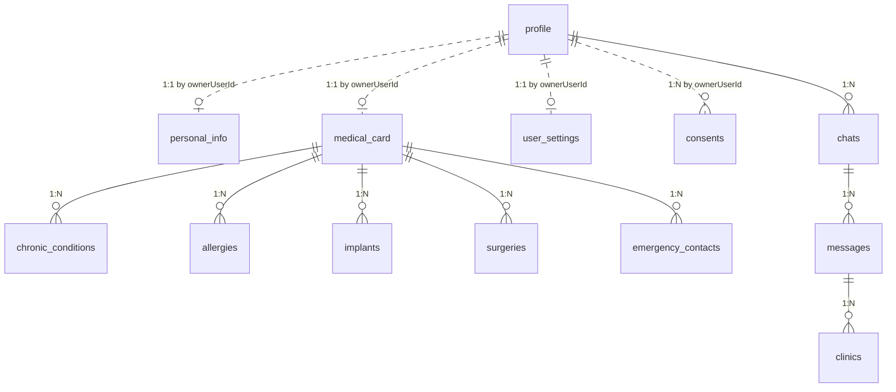

# Local database schema

Working file: entities, relations and fields of the local database.
Filled in step by step. How to use the database: `local-database.md`;
decisions and reasoning: `local-database--notes.md`.

Status per entity: **in review**, **agreed**.

## Entities and relations

Medications, medication intakes, mood and the weather cache are not here yet.
Medications and mood stay as a draft in `local-database--notes.md`; all of them will
be designed when they are implemented.

Solid line: foreign key. Dotted line: link by `ownerUserId` = `profile.serverId`,
not a foreign key, because the profile is deleted on sign-out and the
phone-owned data is kept.

| Entity | Owner | Rows | On sign-out | Status |
|---|---|---|---|---|
| `profile` | Backend (`POST /auth/google`) | One | Cleared | agreed |
| `personal_info` | Phone | One per account | Kept | agreed, open questions below |
| `medical_card` | Phone | One per account | Kept | in review |
| `chronic_conditions` | Phone | Many | Kept | in review |
| `allergies` | Phone | Many | Kept | in review |
| `implants` | Phone | Many | Kept | in review |
| `surgeries` | Phone | Many | Kept | in review |
| `emergency_contacts` | Phone | Many | Kept | in review |
| `user_settings` | Phone | One per account | Kept | in review |
| `consents` | Phone | Many per account | Kept | in review |
| `chats` | Backend | Many | Cleared | in review |
| `messages` | Backend | Many | Cleared | in review |
| `clinics` | Backend (inside message `payload`) | Many | Cleared | in review |

## Conventions

| Field | Where | Why |
|---|---|---|
| `id` (UUID) | Every table | No clashes between records created on different devices |
| `updatedAt` | Every phone-owned table, except `consents` | Which version is newer. `consents` rows are only added or revoked (`revokedAt`) |
| `deletedAt` | Phone-owned tables with many rows, except `consents` | Soft delete, for a future backup. `consents` keeps its history instead |
| `serverId` | Server-backed tables, when the server returns an id | Link to the backend record |
| `syncedAt` / `fetchedAt` | Server-backed tables | When the copy was last refreshed |

## Several accounts on one device

Phone-owned data (`personal_info`, `medical_card` and its lists,
`user_settings`, `consents`) is kept per account, by `ownerUserId`. The app shows only the data of the signed-in user;
when nobody is signed in, it shows none. If another user signs in, both keep
their data.

All accounts share one database key, so the separation is done by the app's
queries, not by encryption.

---

## profile

Account data from the backend. Updated on every sign-in, there is no `GET /me` yet.

| Field | Type | Null | Notes |
|---|---|---|---|
| `id` | UUID | no | Local id |
| `serverId` | text | no | `user.id` from the backend |
| `displayName` | text | yes | From Google. Show `email` when null |
| `email` | text | no | From Google, verified |
| `avatarUrl` | text | yes | Image itself is in the file cache |
| `syncedAt` | datetime | no | Last sign-in |

Not stored: first and last name separately, phone number (no feature uses them).

## personal_info

Data about the user that is not an account field and not a medical record.
Entered by the user, local only. Shown at the top of the medical card.

| Field | Type | Null | Notes |
|---|---|---|---|
| `id` | UUID | no | |
| `ownerUserId` | text, unique | no | `user.id` from the backend. Not a foreign key: `profile` is cleared on sign-out |
| `dateOfBirth` | date | yes | |
| `sex` | enum (female / male / other) | yes | Biological sex, for symptom assessment and medication checks |
| `heightCm` | int | yes | |
| `weightKg` | real | yes | |
| `fallbackLocationLabel` | text | yes | Display name of the home location, from reverse geocoding of the point, e.g. "Košice-Sever" |
| `fallbackLatitude` | real | yes | Sent as `location` in `POST /chat` when GPS is unavailable |
| `fallbackLongitude` | real | yes | |
| `updatedAt` | datetime | no | |

Fallback location: the user's home, used for doctor search (and weather,
regional alerts) when the current position is not available. Set in settings
from the current GPS position or by picking a point on a map. The display
name comes from reverse geocoding of the point (the platform geocoder, no
API key).

Height and weight hold one current value each, no history.

## medical_card

One card per account plus one table per list. List rows point to their card
with `medicalCardId`, so deleting a card deletes its lists.

All entries are self-reported and shown as "My records". The app stores and
shows them, and may send them to the chat as context with the `aiContext`
consent (table `consents`).
It never assesses or scores them (EU MDR).

Current medications are not stored here: the card will show them from
`medications` (designed later, see `local-database--notes.md`).

| Field | Type | Null | Notes |
|---|---|---|---|
| `id` | UUID | no | |
| `ownerUserId` | text, unique | no | `user.id` from the backend. Not a foreign key: `profile` is cleared on sign-out |
| `bloodType` | enum (A+ / A- / B+ / B- / AB+ / AB- / O+ / O-) | yes | |
| `insuranceCompany` | enum (vszp / dovera / union / other) | yes | Stored as a code, the UI shows the name. No insurance number: in Slovakia it is the birth number |
| `insuranceCompanyOther` | text | yes | Only when `insuranceCompany = other`, e.g. a foreign insurer |
| `gpName` | text | yes | General practitioner |
| `gpPhone` | text | yes | |
| `pregnancyDueDate` | date | yes | Hidden automatically after the date |
| `needsStepFreeAccess` | bool | no | Wheelchair, stroller. Default for the barrier-free filter (Epic 4) |
| `notes` | text | yes | Free text for anything else |
| `updatedAt` | datetime | no | |

### Common fields of the list tables

`id` (UUID), `medicalCardId` (UUID → `medical_card`, cascade delete),
`createdAt`, `updatedAt`, `deletedAt`.

### chronic_conditions

| Field | Type | Null | Notes |
|---|---|---|---|
| `name` | text | no | |
| `since` | int (year) | yes | |
| `note` | text | yes | |

### allergies

Allergies and intolerances in one list.

| Field | Type | Null | Notes |
|---|---|---|---|
| `name` | text | no | "Penicillin", "Lactose" |
| `kind` | enum (allergy / intolerance) | no | An allergy can cause anaphylaxis, an intolerance cannot |
| `category` | enum (medication / food / other) | no | Food and medication entries feed interaction checks (Epic 3) |
| `reaction` | text | yes | |

### implants

Implants and medical devices: pacemaker, insulin pump, prostheses.

| Field | Type | Null | Notes |
|---|---|---|---|
| `name` | text | no | |
| `note` | text | yes | |

### surgeries

| Field | Type | Null | Notes |
|---|---|---|---|
| `name` | text | no | Free text |
| `year` | int | yes | |
| `note` | text | yes | |

### emergency_contacts

| Field | Type | Null | Notes |
|---|---|---|---|
| `name` | text | no | |
| `relation` | text | yes | "Mother" |
| `phone` | text | no | |
| `isPrimary` | bool | no | At most one primary per card: unique index on `medicalCardId` where `isPrimary` and not deleted |

Postponed items are listed in `local-database--notes.md` → "Postponed".

## user_settings

Per-account settings. Device settings (language, theme, onboarding, app lock,
first launch) stay in preferences: they are needed before sign-in or before the
database can be opened. See `preferences.md`.

| Field | Type | Null | Notes |
|---|---|---|---|
| `id` | UUID | no | |
| `ownerUserId` | text, unique | no | `user.id` from the backend |
| `medicationRemindersEnabled` | bool | no | Default true. Scheduled locally |
| `repeatReminderMinutes` | int | yes | Repeat an unmarked reminder after N minutes. Null: no repeat |
| `moodRemindersEnabled` | bool | no | Default true. Scheduled locally |
| `moodReminderTime` | text "HH:mm" | no | Default "20:00" |
| `healthAlertsEnabled` | bool | no | Default true. Sent by the server: send to the backend once it accepts it |
| `recommendationsEnabled` | bool | no | Default false. Sent by the server, as above |
| `updatedAt` | datetime | no | |

The row is created with the defaults on the user's first sign-in.

## consents

One row per grant, so the history is kept. Revoking sets `revokedAt` on the
active row; granting again adds a new row.

| Field | Type | Null | Notes |
|---|---|---|---|
| `id` | UUID | no | |
| `ownerUserId` | text | no | `user.id` from the backend. Index with `type` |
| `type` | enum (terms / aiChat / aiContext) | no | |
| `version` | int | no | Version of the consent text, from `ConsentVersions` |
| `grantedAt` | datetime | no | |
| `revokedAt` | datetime | yes | Null: still active |

A consent is valid when its latest row for the type has no `revokedAt` and
`version` >= the current `ConsentVersions` value.

Terms are accepted before sign-in, so they are first stored on the device
(`termsAcceptedVersion` in preferences). After sign-in, a `terms` row is added
here if the user has none for the current version.

"Delete my data" removes the rows, like the rest of the user's data. Proof of
consent for the server belongs on the backend once it has an endpoint for it.

## chats

Source: `GET /chat/sessions` returns `{ id, title, createdAt }`, newest first.
No `updatedAt`, so a changed chat is only noticed by loading its history.

| Field | Type | Null | Notes |
|---|---|---|---|
| `id` | UUID | no | |
| `profileId` | UUID → `profile` | no | Cascade delete: deleting the profile on sign-out deletes the whole chat cache |
| `serverId` | text, unique | no | `sessions[].id`, or `sessionId` from `POST /chat` |
| `title` | text | yes | `sessions[].title`, SSE `title` event, `PATCH /chat/sessions/:id` |
| `createdAt` | datetime | no | `sessions[].createdAt` |
| `fetchedAt` | datetime | no | Last time the chat was in the server list |
| `historyFetchedAt` | datetime | yes | Null: history never loaded, show a loader, not an empty chat |

## messages

Source: `GET /chat/history/:sessionId` returns `[{ role, content, payload }]`.
No id and no date per message, so the history of a chat is replaced as a whole.

| Field | Type | Null | Notes |
|---|---|---|---|
| `id` | UUID | no | |
| `chatId` | UUID → `chats` | no | Cascade delete |
| `position` | int | no | Index in the history array. Unique with `chatId` |
| `role` | enum (user / assistant) | no | `role`. Rows with `system` are skipped |
| `text` | text | no | `content` |

## clinics

Snapshot of `payload.doctors` of an assistant message. Not deduplicated: `url`
is not unique (a Google Maps link shared by a building, or the register link),
and the server never updates an old payload.

| Field | Type | Null | Notes |
|---|---|---|---|
| `id` | UUID | no | Used by the clinic details route |
| `messageId` | UUID → `messages` | no | Cascade delete |
| `position` | int | no | Order in `doctors[]` |
| `name` | text | no | |
| `speciality` | text | no | |
| `address` | text | no | |
| `url` | text | no | |
| `phone` | text | yes | |
| `email` | text | yes | |
| `additionalInfo` | text | yes | |

### Cache flow

1. Chat list: upsert by `serverId`; chats missing from the response are deleted
   with their messages.
2. Opening a chat: show the local copy, load the history, then in one
   transaction delete the chat's messages and insert the new ones.
3. Sending: a new `sessionId` creates a chat row. The reply is collected in
   memory and written with its clinics when the stream ends. The `title` event
   updates the title. A broken stream is fixed by the next history load.
4. Sign-out: delete the `profile` row; chats, messages and clinics cascade.
   Sign-in with another account replaces the `profile` row the same way.

Ask the backend: `updatedAt` in `GET /chat/sessions`.
